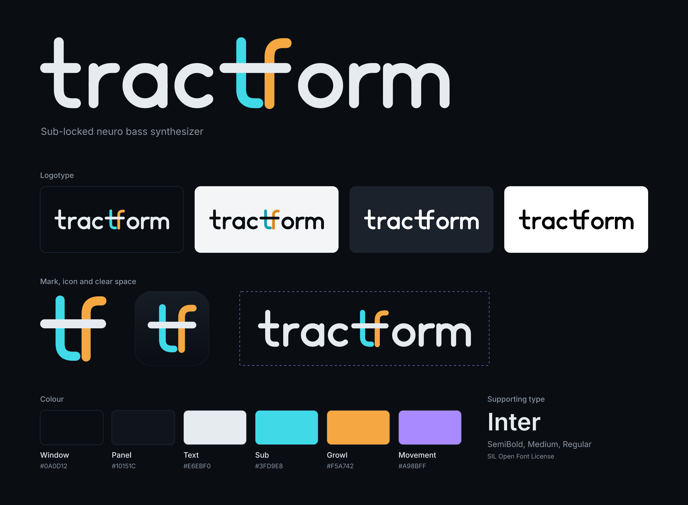

# Tract Form identity

The logotype, the mark, the app icon and the rules for using them. Everything
here is generated by [build.py](build.py); edit that, not the files.

```sh
brand/build.py                 # logos, icons, brand sheet, press images
brand/build.py --screenshots   # also re-render the interface screenshots first
```

It needs [uv](https://docs.astral.sh/uv/) and `resvg` (`brew install resvg`).



## The idea

The mark is a **tf** in which the f is the t turned upside down, joined by one
bar: the synthesizer's two reese voices as inversions of each other, tied
together by the master. The logotype spells the name in the same strokes, and
the t that ends "tract" and the f that begins "form" *are* the mark, bridging
the two words.

## Files

| File | Use it for |
|---|---|
| `logo/tract-form-logotype-on-dark.svg` | The logo, on dark backgrounds. The default |
| `logo/tract-form-logotype-on-light.svg` | The logo, on light backgrounds |
| `logo/tract-form-logotype-mono-white.svg`, `-mono-black.svg` | One-colour printing, engraving, watermarks |
| `logo/tract-form-mark-*.svg` | The mark alone, where the name is already nearby |
| `logo/outlined/` | The same files as filled shapes with no strokes, for print and for tools that mishandle strokes |
| `logo/png/` | Bitmaps: logotype 2400 px wide, mark 1024 px |
| `icon/tract-form-icon.svg`, `icon/TractForm.icns`, `icon/png/` | The app icon, with macOS margins |
| `icon/tract-form-tile.svg` | The icon edge to edge, for avatars and favicons |

## Using the logo

- **Clear space**: keep one x-height of the lettering (the height of the "o")
  free on every side.
- **Smallest size**: logotype 120 px or 25 mm wide; mark 16 px or 5 mm.
- **Backgrounds**: use `on-dark` on dark, `on-light` on light, and a mono
  version on photographs or strong colours.
- **Do not** redraw it, change its colours, set the name in another typeface
  beside it, stretch it, outline it, or add effects.

## Colour

| Name | Hex | Meaning in the product |
|---|---|---|
| Window | `#0A0D12` | Background |
| Panel | `#10151C` | Surfaces |
| Text | `#E6EBF0` | Lettering and the bar of the mark |
| Sub | `#3FD9E8` | The master sine and the sub: the clean path, and the t |
| Growl | `#F5A742` | The processed path, and the f |
| Movement | `#A98BFF` | Modulation |

On light backgrounds the cyan and amber deepen to `#0E9FB0` and `#DC8A17` to
keep their contrast.

## Type

The logotype is custom lettering and is not a font. Supporting text is set in
[Inter](https://rsms.me/inter/) (SIL Open Font License), in SemiBold, Medium and
Regular.

## Name

In running text: **Tract Form**, two words, with capitals.
