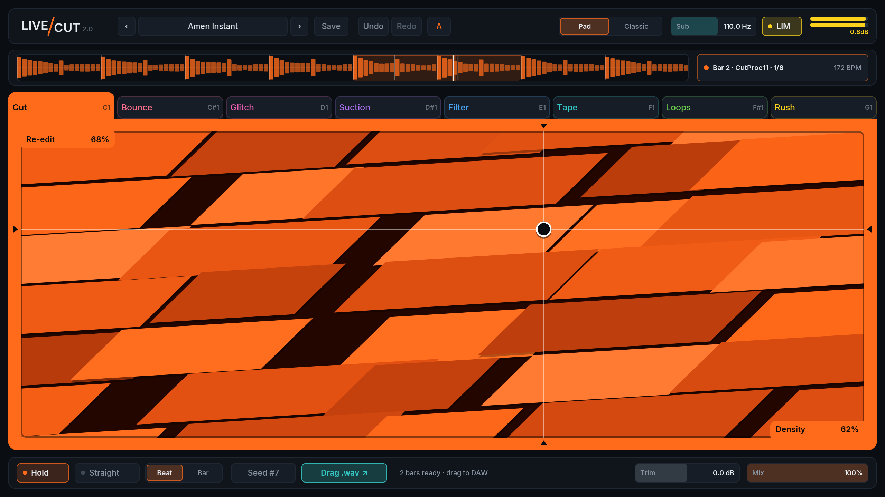
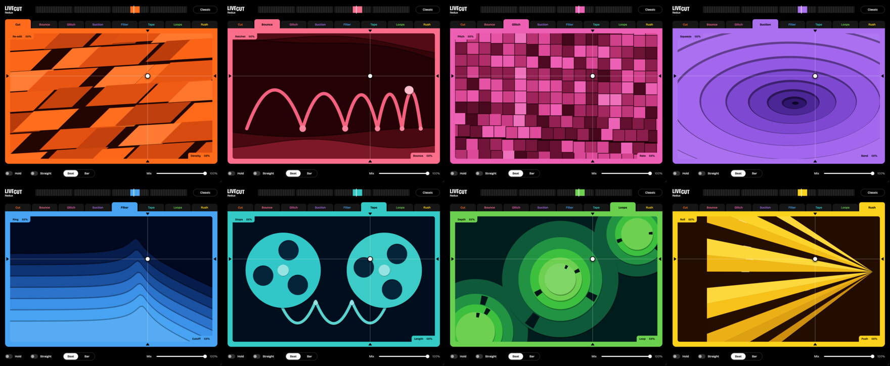

# Livecut Redux

Livecut Redux, published by Human Being Audio, is a live beat slicer. Instead
of chopping audio into equal slices, it builds *phrases* out of *blocks* of
*cuts* whose length and number of repeats depend on the cutting procedure, the
way a jungle or drum & bass producer would re-edit a break. It is based on
Nick Collins' [BBCut](https://composerprogrammer.com/bbcut2.html) library for
SuperCollider.

CutProc11, WarpCut and SQPusher come from BBCut. Bounce is new to this port.
It cuts the way 2020s club music does: triplet bounces against a straight beat,
a ratchet that climbs in semitones to close each phrase, and the odd halftime
bar.

This repository is a ground-up port of Remy Muller's original Livecut plugin to
[JUCE 9](https://juce.com) as a native 64-bit **VST3**, **AU** and
**Standalone** app, for current DAWs (Ableton Live 12, Logic, Reaper, Bitwig…)
on macOS, Windows and Ubuntu. Up to 1.0.0-beta.1 it was called
Livecut; Livecut Redux opens sessions saved with those versions.



Press the pad to cut and let go to stop on the next beat or bar; drag to play
two settings of the program at once. Each of the eight programs has its own
colour and its own picture, drawn in pieces of that colour, which keeps time
with the host, moves with the pad and answers every cut. The strip across the
top is the phrase, cut into its bars: the block playing now is in the
program's colour, and the line is the playhead. Livecut Redux follows the
host's transport; while the host is stopped, dry audio passes through the
output trim.



The wordmark opens an About sheet with the plug-in's story. [docs/skin.md](docs/skin.md)
has the editor's design rules.

## Install

Find Livecut Redux on the [studio downloads page](https://humanbeingaudio.com/#plugins).

- **macOS** — the universal, signed and notarized PKG installs the VST3, AU and standalone app.
- **Windows x64** — run the signed installer. It installs the VST3 in the system VST3 folder and adds the standalone to the Human Being Audio Start menu folder.
- **Ubuntu 26.04 x86_64** — extract the archive, copy the complete VST3 bundle to `~/.vst3/` and rescan your host. The standalone runs directly from the extracted folder.

## The pad

New instances open on the pad. Eight programs sit above it: Cut, Bounce,
Glitch, Suction, Filter, Tape, Loops and Rush.

- **Cut**, **Bounce** and **Glitch** play the cut procedures: from the break
  nearly as it is to busy jungle editing, triplet bounces with climbing
  ratchets, and fast repeats through a crusher.
- **Suction** squeezes the cuts into a narrow, singing band that bursts open on
  every cut and sucks shut behind it.
- **Filter** sweeps a resonant low-pass from dark to open and rings each roll
  out on a tuned note that ducks under the hits.
- **Tape** lets the track play and brakes it to a halt on the grid, from once
  every four bars to every beat, then spins it back up into the next hit.
- **Loops** lets the track play a bar, half a bar or a beat, then loops it,
  folding into shorter and shorter loops of its first hit before it catches
  the track again.
- **Rush** lets the track play and rolls the last beats of every bar into the
  next downbeat: evenly, rushing and rising, or dragging and falling.

Hold keeps cutting after you let go, Mix blends the input with the program,
and Straight keeps every cut on even divisions of the beat, so a program
plays no triplets.

## Classic

The Classic surface keeps the four cut procedures with every one of their
controls. Sessions saved before the pad open on it. It also holds everything
built between 0.2.0 and the pad:

- **Capture**: keep the last complete phrase and save it as a stereo float WAV
  ([notes](docs/releases/0.3.0.md)).
- **Perform**: Audio Hold, Swing and Accent ([notes](docs/releases/0.4.0.md)).
- **Recut**: Studio's 500 ms look-ahead, Attack Align and Reverse
  ([notes](docs/releases/0.5.1.md), [guide](docs/releases/0.5.0.md)).
- **Impact**: Slice Filter, Drive / Wavefold and a Transient Shaper
  ([notes](docs/releases/0.6.0.md)).
- **Fracture**: the GrainCut and TapeCut readers, and Ring / Frequency Shift
  ([notes](docs/releases/0.7.0.md)).
- **Resonance**: a four-voice tuned resonator, a choice of effect order, and
  Spectral Freeze / Smear ([notes](docs/releases/0.8.0.md)).

## Building

Requirements: CMake 3.25+, and a recent Xcode (macOS) or Visual Studio (Windows).

```sh
git clone --recurse-submodules https://github.com/seandearnaley/human-being-audio.git
cd human-being-audio/products/livecut-redux
cmake -S . -B build -DCMAKE_BUILD_TYPE=Release
cmake --build build --config Release --parallel
ctest --test-dir build --build-config Release --output-on-failure
```

The plugins end up in `build/Livecut_artefacts/Release/{VST3,AU,Standalone}`,
as `Livecut Redux.vst3`, `Livecut Redux.component` and `Livecut Redux.app`.

Useful options:

- `-DLIVECUT_COPY_PLUGIN_AFTER_BUILD=ON` installs the plugins into your user
  plug-in folders after each build.
- `-DCMAKE_OSX_ARCHITECTURES=arm64` builds for Apple Silicon only, which halves
  build times while developing. The default is a universal binary.

CI validates every build with [pluginval](https://github.com/Tracktion/pluginval)
at strictness level 10 (including Steinberg's VST3 validator) and with `auval`.

## Releases

Follow the [studio release guide](../../factory/release/README.md). Select Livecut Redux in the Studio release workflow. GitHub signs the Windows installer, signs and notarizes the Mac package, and publishes all three platforms after installed-package checks.

To inspect the Mac installer locally, use a universal Release build and the version from this product's CMake project:

```sh
packaging/macos/make-installer.sh build/release/Livecut_artefacts/Release 1.0.2 dist --unsigned
```

Before it installs, the installer
removes Livecut 0.1.0 to 1.0.0-beta.1 from `/Library/Audio/Plug-Ins` and
`/Applications`, since Livecut Redux has the same plug-in IDs and hosts would
otherwise list it twice. Anything else called Livecut, such as the original
2004 Livecut, stays.

## Credits

- **Remy Muller** (mdsp @ Smartelectronix) wrote the original Livecut
  (2003–2004).
- **Nick Collins** designed the BBCut algorithms Livecut implements.
- Livecut-GUI 0.1, a JUCE 6 fork, exposed every parameter in a GUI.
- **Sean Dearnaley** wrote Livecut Redux, this project's ground-up rewrite,
  published by **Human Being Audio**.
- The editor is set in [Bricolage Grotesque](https://github.com/ateliertriay/bricolage)
  by Mathieu Triay, under the SIL Open Font License
  ([assets/fonts/OFL.txt](assets/fonts/OFL.txt)).

## License

Livecut Redux is free software: you can redistribute it and/or modify it under
the terms of the GNU General Public License as published by the Free Software
Foundation, either version 3 of the License, or (at your option) any later
version. See [LICENSE](LICENSE). The original Livecut was released under the
GPL v2 or later.

Livecut Redux builds on [JUCE](https://github.com/juce-framework/JUCE), which
is dual-licensed under the AGPLv3 and a commercial JUCE licence; this project
uses it under the AGPLv3. Distributing a closed-source build would require a
commercial JUCE licence. The VST3 SDK is MIT-licensed.
