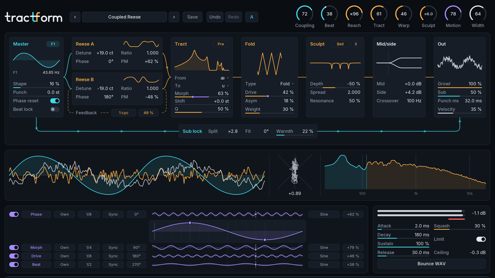

<p align="center">
  <picture>
    <source media="(prefers-color-scheme: dark)" srcset="brand/logo/tract-form-logotype-on-dark.svg">
    
  </picture>
</p>

A monophonic bass synthesizer for neurofunk drum & bass, by Human Being Audio.



One master sine drives everything. It phase-modulates two detuned reese voices,
and it also becomes a clean, mono, phase-locked sub that bypasses all processing.
The growl can be as violent as you like and the sub never moves.

VST3 and standalone on macOS, Windows x64 and Ubuntu 26.04 x86_64. Audio Unit on macOS. Beta 0.2.

## What it does

- **Master sine** sets the pitch, phase-modulates both reese voices and becomes the sub.
- **Reese A and B** are sines with detune, ratio, phase offset and a tempo-synced
  feedback loop into their phase.
- **Tract** morphs a five-formant filter between two vowels.
- **Fold** is an anti-aliased wavefolder with drive and asymmetry.
- **Mid/side** keeps everything below the crossover mono.
- **Movement** is four tempo-locked lanes for phase, tract, fold and detune.
- **Resample** renders four bars offline at 16× and hands you the file to drag
  into your session.

## Install and release

The [studio downloads page](https://humanbeingaudio.com/#tract-form) lists the Mac PKG, Windows x64 installer and Ubuntu 26.04 x86_64 archive. See the [studio release guide](../../factory/release/README.md) for packaging, signing and verification.

## Building

Needs CMake 3.25+, Ninja and the Xcode Command Line Tools. Dependencies are
fetched and pinned by CMake.

```sh
cmake --preset dev
cmake --build --preset dev
ctest --preset dev
tools/scripts/install.sh
```

That builds everything, runs the tests, and copies the VST3 and AU into
`~/Library/Audio/Plug-Ins` with a fresh signature. For work on the sound alone, the `engine` preset
builds and tests the DSP in seconds without JUCE or Visage.

Logos, the app icon and usage rules are in [brand/](brand); screenshots, a fact
sheet and ready-to-use copy are in [press/](press).

The design is in [docs/superpowers/specs](docs/superpowers/specs/2026-11-15-tract-form-design.md);
[AGENTS.md](AGENTS.md) describes the layout and how to check work by measurement.

## Licence

AGPL-3.0-or-later. See [LICENSE](LICENSE).
